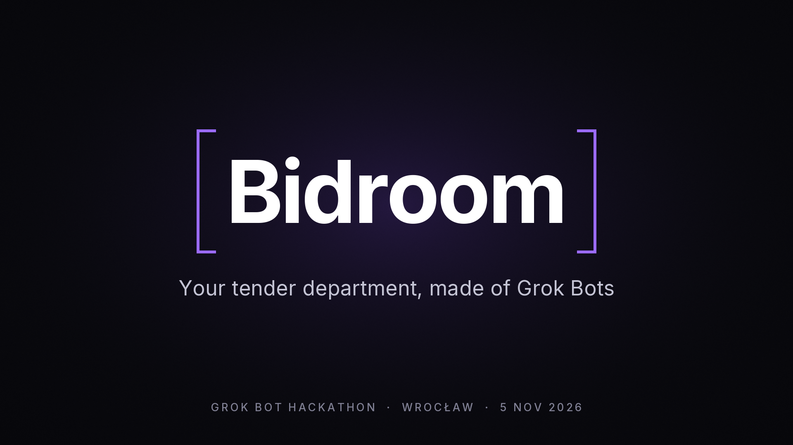

# Bidroom



**Demo:** [full unedited bot run (6 min)](demo/bidroom-raw-run.mp4) · edited 60–90 s video: coming in `demo/`.

**A public-tender department made of Grok Bots, for a small IT company.**

Judges watch **only 1 minute** of the demo video. The cut we ship is 45 seconds ([script](docs/pitch/demo-script.md)). This README is the showcase for the rest: what Bidroom does, how the bots split the work, and how to run it.

Poland spent **PLN 587 bn on public procurement in 2024** ([PIE](https://pie.net.pl/wp-content/uploads/2026/05/Zamowienia-publiczne-11.05.pdf)). A 25-person software house has no one to watch tenders, read 80-page specifications, or check the offer before it goes out. Bidroom does that with a team of four Grok Bots and one human approval.

Track: **Multi-agent Systems** (with a human in the loop).

## How it works

```
scout (this repo)              e-Zamówienia public API → filter by company profile → shortlist + kickoff message
        │
        ▼
Grok Bot group "Bidroom"
  @Analyst   picks the best tender from the shortlist
  @Runner    opens the procurement platform in its own browser, downloads the SWZ, extracts requirements
  @Analyst   marks each requirement MET / NOT MET → GO / NO-GO
  @Writer    drafts the offer, marks gaps as [DO UZUPEŁNIENIA]
  @Komisja   plays the evaluation committee and tries to reject it (max 2 rounds with Writer)
        │
        ▼
Slack summary → a human approves. Nothing is ever submitted or signed by a bot.
```

**Why Grok Bot:** tender notices have a public API, but the documents sit on a dozen procurement platforms with no API (platformazakupowa.pl, logintrade, ezamawiajacy.pl, marketplanet, even Google Drive). A Grok Bot has its own cloud computer and browser, so it fetches them the way a person would. Bots hand work to each other and argue in one group chat; the result lands in Slack.

## Run scout

```bash
node scout/index.mjs --top 3
```

Node 22+, no dependencies, no API keys. Paste the printed kickoff message into the Bidroom group. Details: [`scout/README.md`](scout/README.md).

## Repo map

| Path | What |
|---|---|
| [`scout/`](scout/) | Tender finder and kickoff generator |
| [`docs/product/`](docs/product/) | Concept, architecture, bot instructions |
| [`docs/research/`](docs/research/) | Data sources, strategy |
| [`docs/pitch/`](docs/pitch/) | 45-second judge video (1-minute cap) and the stage script |
| [`sessions/`](sessions/) | AI coding session exports |
