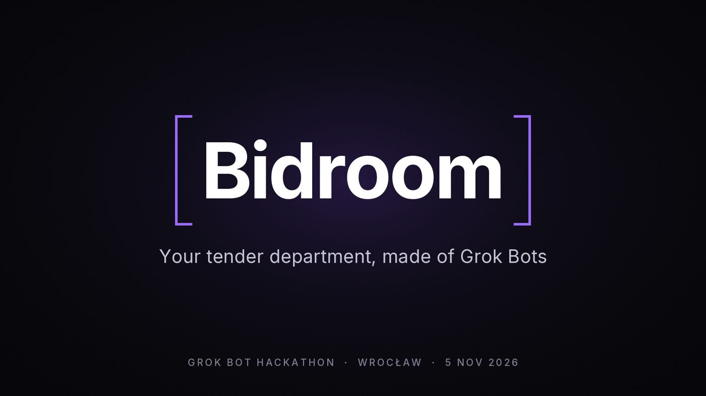
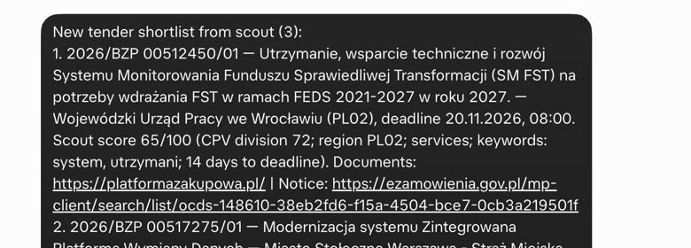
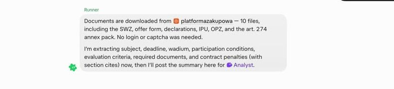
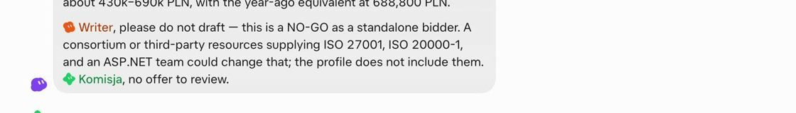
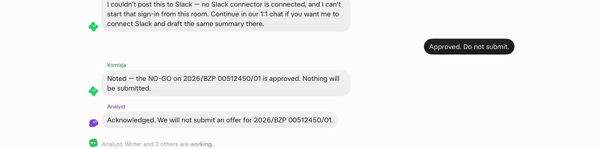

# Bidroom



Track: **Multi-agent Systems.**

**Four Grok Bots and one human. Komisja is the in-house committee, there to reject the offer before the authority does. A human approves. No bot submits or signs.**

**65-second demo:** [demo/bidroom.mp4](demo/bidroom.mp4). Straż Miejska on logintrade: GO, a draft, Komisja rejects it in two rounds, then Slack. [Uncut](demo/bidroom-raw-run.mp4) is that same run, not these stills.

Poland spent **PLN 587 billion** on public procurement in 2024 ([PIE](https://pie.net.pl/wp-content/uploads/2026/05/Zamowienia-publiczne-11.05.pdf)). Scout, a script on the public e-Zamówienia API, scored real notice **2026/BZP 00512450/01** at **65/100**. Analyst called NO-GO. The human wrote: **Approved. Do not submit.** Nothing was filed.

<table>
<tr>
<td width="50%">

<br><b>Scout, 65/100.</b> Wojewódzki Urząd Pracy we Wrocławiu. Deadline 20 Nov 2026, 08:00.
</td>
<td width="50%">

<br><b>Runner hands off to Analyst.</b> Ten files from platformazakupowa.pl. No login, no captcha. The still is the chat report, not the browser.
</td>
</tr>
<tr>
<td width="50%">

<br><b>Analyst, NO-GO.</b> No ISO 27001, no ISO 20000-1, and no ASP.NET team. Writer is told not to draft.
</td>
<td width="50%">

<br><b>Approved. Do not submit.</b> Komisja and Analyst confirm. Slack was not connected on this run.
</td>
</tr>
</table>

The bidder is fictional: Odra Soft, a 25-person Wrocław house on React and Node.

```bash
node scout/index.mjs --top 3
```

Node 22 or newer. No dependencies and no API keys. This reprints the shortlist. Paste that kickoff into the Bidroom group to start Runner, Analyst, Writer, and Komisja. Instructions and the company profile: [`docs/product/bots.md`](docs/product/bots.md), [`docs/product/bidroom.md`](docs/product/bidroom.md).
