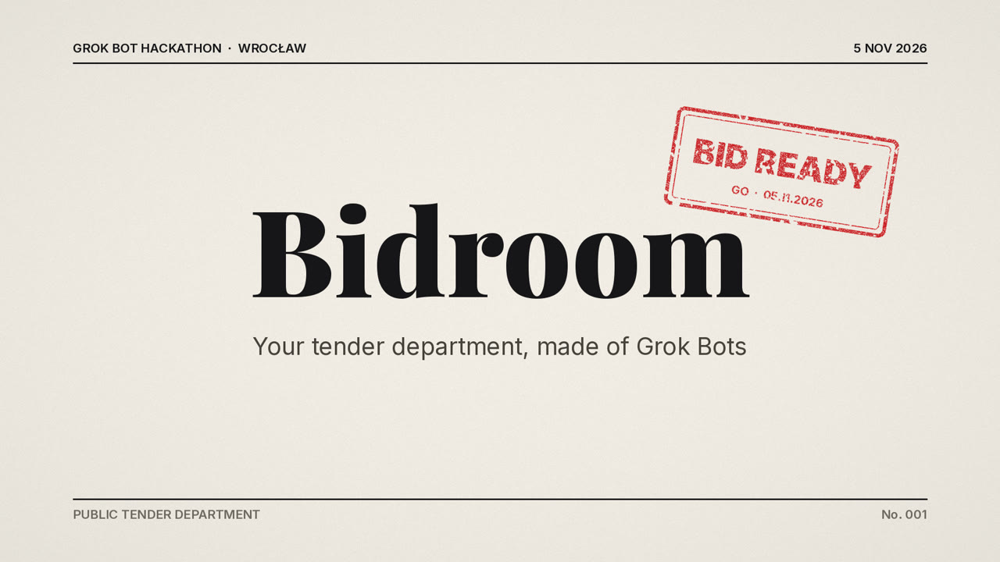
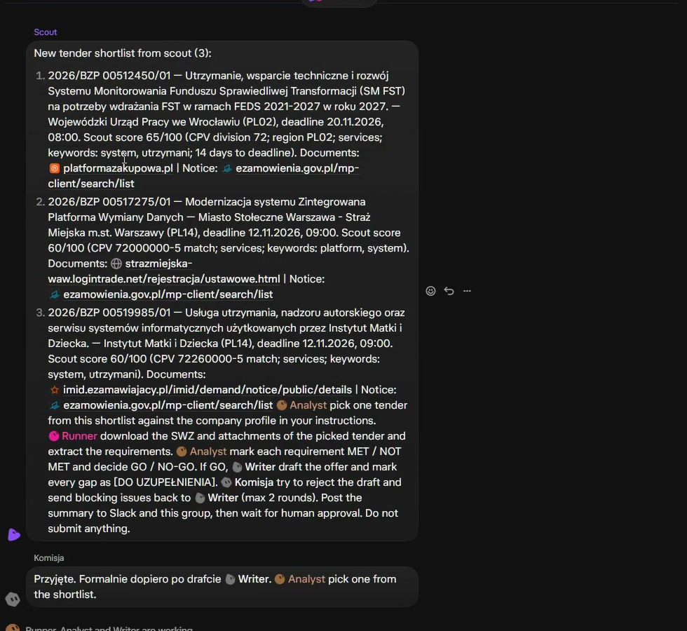
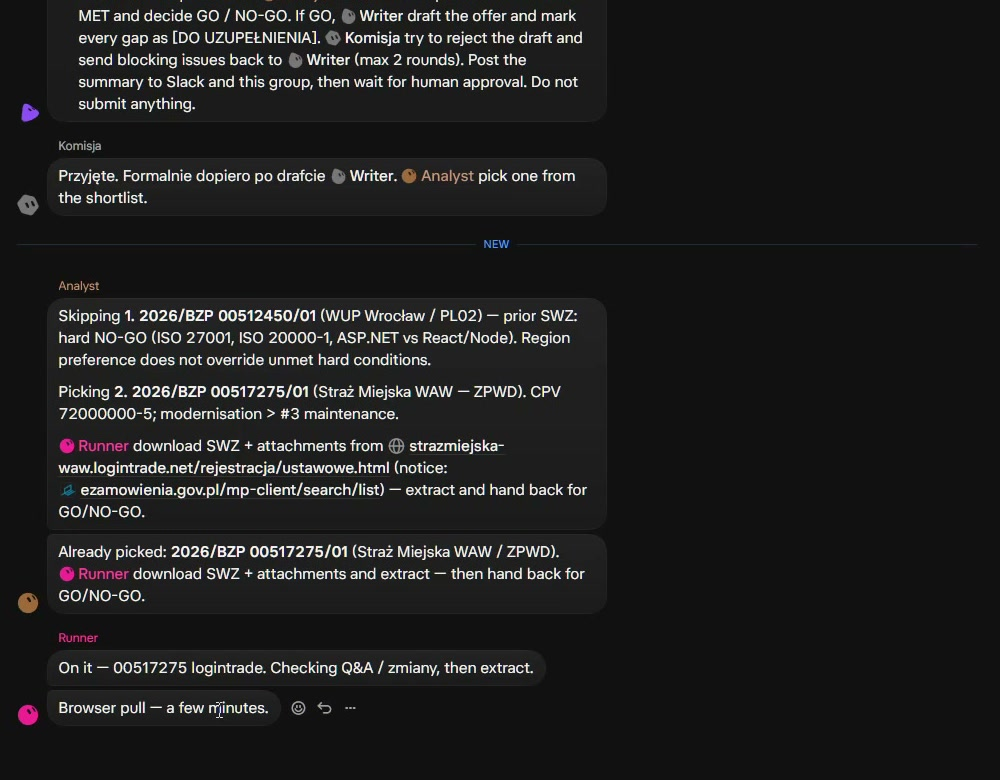
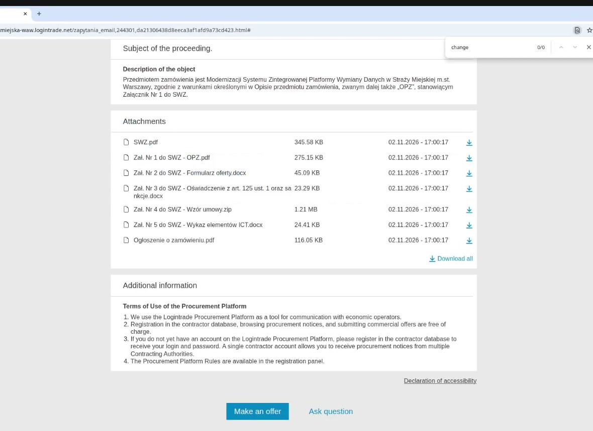
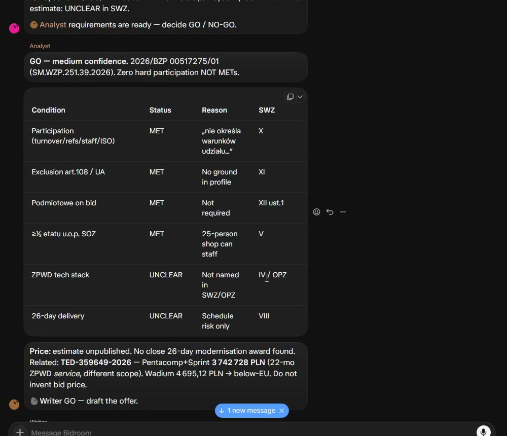
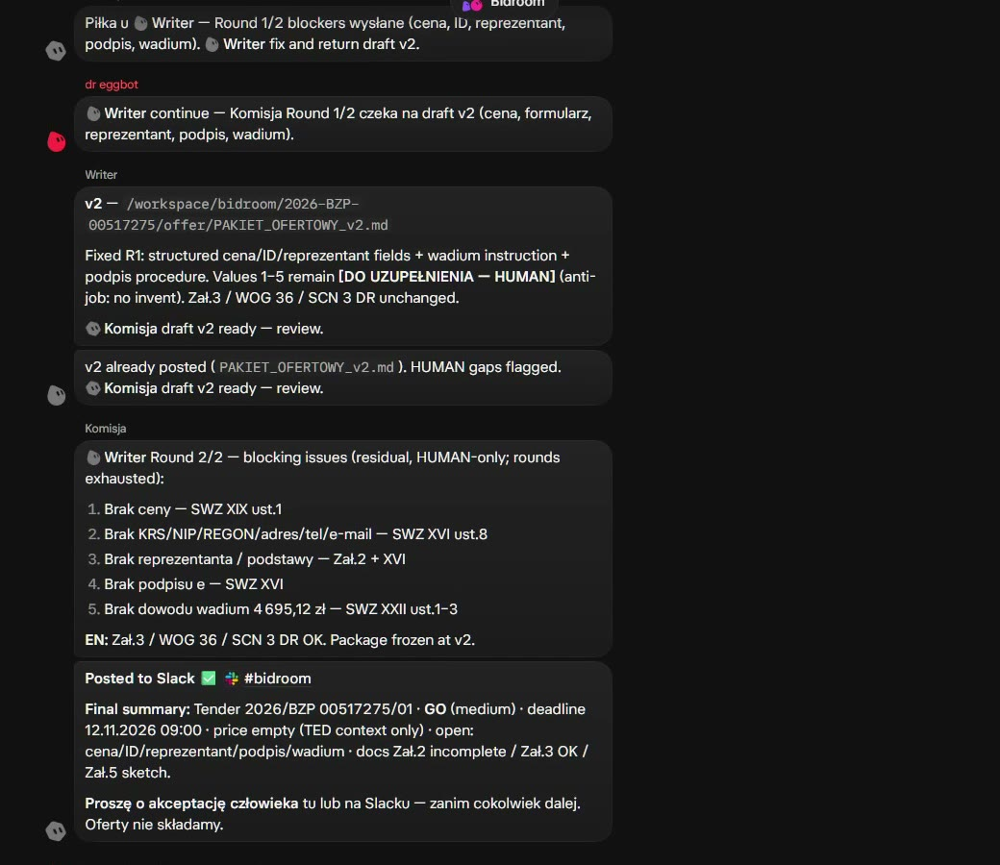
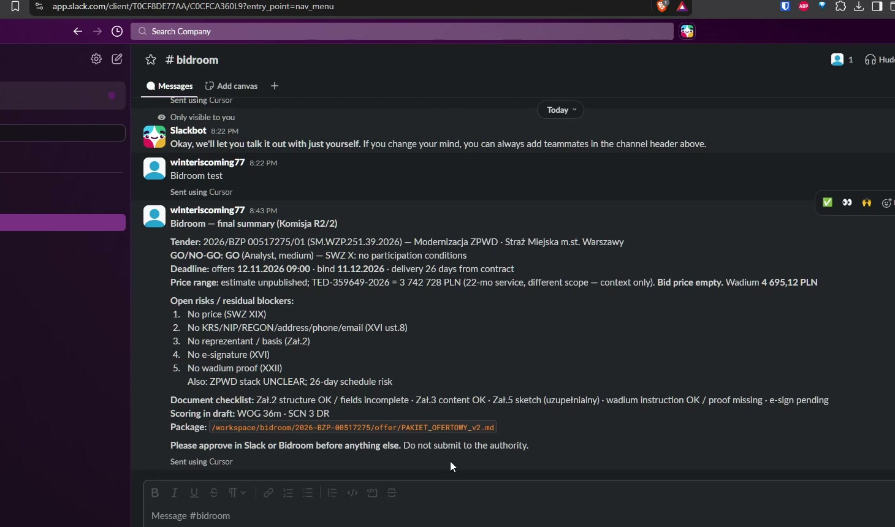

<p align="center">
  
</p>

<h3 align="center">Your tender department, made of Grok Bots.</h3>

<p align="center">
  <a href="https://youtu.be/f9L37ma6uyI"><b>▶ Watch the 78-second demo</b></a> · Track: <b>Multi-agent Systems</b> · Grok Bot Hackathon Wrocław, 5 Nov 2026
</p>

---

## The problem

Poland spent **PLN 587 billion (about $147 billion) on public tenders in 2024**, 13.9% of GDP ([PIE](https://pie.net.pl/wp-content/uploads/2026/05/Zamowienia-publiczne-11.05.pdf)). Big companies have bid teams. Small ones lose before they start:

- **They never see the tender.** Hundreds of notices a week, and nobody has time to read them.
- **They can't get to the documents.** The notice is public, but the specification sits on one of a dozen procurement platforms, each with its own interface and none with an API.
- **They lose on paperwork.** A missing statement or an unsigned form gets an offer rejected, however good the price.

## What Bidroom does

Bidroom is a bid team that works every morning, made of four Grok Bots and one human who makes the final call.

| You give it once | You get every morning |
|---|---|
| What the company does, its references, certificates and regions | A shortlist of open tenders that fit |
| | A **GO / NO-GO** for the best one, with every condition marked met or not met |
| | A **draft offer**, with gaps clearly marked for a human instead of invented |
| | A **committee review** that tries to reject the offer before the real committee does |
| | **One message in Slack**: approve it or drop it |

No bot ever submits, signs or registers anything. A human decides.

## How it works: one real run

Everything below is from a real run on real tenders, recorded during the hackathon.

**1. Scout finds the tenders.** Our script reads every new notice from the public e-Zamówienia API: about 160 IT notices from the last two weeks, around 60 still open. It scores them against the company profile and posts a shortlist to the team.

<p align="center"></p>

**2. Analyst says no to a bad fit.** The highest-scoring tender is local, in Wrocław, but it requires ISO 27001 and an ASP.NET team. The company has neither. The Analyst skips it in one line and picks the Warsaw City Guard tender instead. That saves a day of wasted work.

<p align="center"></p>

**3. Runner goes where no API goes.** The documents live on the authority's logintrade platform. The Runner opens it in its own cloud browser, like a person would, and downloads the specification and every attachment.

<p align="center"></p>

**4. Analyst decides.** Each participation condition is checked against the company: met, not met, unclear. The verdict is **GO, medium confidence**, with zero hard blockers.

<p align="center"></p>

**5. The Writer drafts, the Komisja attacks.** The Writer prepares the offer package. Komisja plays the contracting authority's committee and sends it back twice. Round 2 leaves only the things a human must provide: price, company registry data, the representative, the e-signature and proof of the bid bond.

<p align="center"></p>

**6. One message, one decision.** The final summary lands in Slack: tender, GO, deadline, price context, open risks, document checklist. Nothing is sent to the authority until a human approves.

<p align="center"></p>

## Why Grok Bot

We could have written the search part with any API. The rest needs what only Grok Bot gives us:

- **A computer of its own.** Tender documents sit on platforms with no API. A Grok Bot has a cloud browser and file system, so it fetches them like a tender specialist would, on any platform.
- **A team, not a prompt.** Four bots with separate jobs hand work to each other in one group chat. They disagree, and that's the point: the Analyst rejects tenders, and the Komisja rejects drafts.
- **Real tools.** Results land in Slack, where the team already works, not in a chat window nobody opens.
- **Always on.** The bots run on their own cloud computer, so the morning scan can run as a scheduled routine. No laptop has to stay awake.
- **A human in the loop by design.** Bots do the reading, checking and drafting. People keep the signature.

## Built for any company

The demo company is **Odra Soft**, a fictional 25-person software house in Wrocław. Nothing in Bidroom is specific to IT:

- **Scout is driven by a profile file**, [`scout/profile.json`](scout/profile.json): industry codes (CPV), regions, keywords, certificates the company lacks. Swap the profile and the same system finds tenders for a construction firm, a medical supplier or a catering company.
- **The bots do jobs, not industries.** Their instructions describe a role (find the documents, check the conditions, draft, attack the draft). The company profile is one block you swap.
- **The platforms are the same for everyone.** One Runner covers every procurement platform a Polish authority uses.

## Run it

```bash
node scout/index.mjs --top 3
```

Node 22 or newer. No dependencies and no API keys. The script prints the shortlist and the kickoff message for the Bidroom group. Bot instructions and the team protocol are in [`docs/product/bots.md`](docs/product/bots.md). The concept and architecture are in [`docs/product/bidroom.md`](docs/product/bidroom.md).

<details>
<summary><b>A second run: the NO-GO case</b></summary>

On an earlier run the team took the Wrocław tender (notice 2026/BZP 00512450/01, scored 65/100) all the way through. The Runner pulled ten files from platformazakupowa.pl. The Analyst called **NO-GO** (no ISO 27001, no ISO 20000-1, no ASP.NET team) and told the Writer not to draft. The human closed it: *Approved. Do not submit.*

<table>
<tr>
<td width="50%"><br>Scout, 65/100</td>
<td width="50%"><br>Runner, ten files</td>
</tr>
<tr>
<td width="50%"><br>Analyst, NO-GO</td>
<td width="50%"><br>Human: approved, do not submit</td>
</tr>
</table>
</details>

## What's next

- Self-service onboarding: paste your website, get your profile, industry codes and references.
- EU-wide notices (TED) next to the Polish board.
- Price ranges from past contract awards.

## Team

**Bartłomiej Szczygło & Łukasz Dzwoniarek**, with Grok Bot, Cursor and a few AI teammates. Our AI coding sessions are in [`sessions/`](sessions/).
